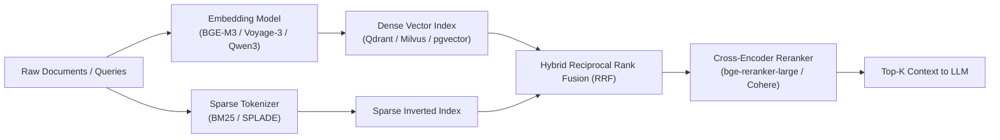

  

  
  
  
  
  
  
  
  

---

# 🚀 Awesome Text Embeddings & Vector Search

> ⚡ **A curated directory of top-tier SaaS platforms, hosted APIs, open-source embedding models, vector databases, and approximate nearest neighbor (ANN) search engines.**  
> 🔍 *Focused on Multilingual Embeddings, Hybrid Retrieval (Dense + Sparse), Matryoshka Representation Learning, and High-Throughput Similarity Indexing.*

**Last updated: March 2026**

---

## 📌 Executive Summary & Architecture Overview

Text embeddings and vector search engines form the cognitive foundation layer for modern **Retrieval-Augmented Generation (RAG)**, semantic knowledge graphs, real-time recommendation engines, and enterprise AI search pipelines:
- **Text & Multimodal Embeddings:** High-dimensional dense vector representations (e.g., 256 to 4,096 dimensions) that encapsulate syntactic and semantic relationships across languages and modalities.
- **Hybrid Retrieval (Dense + Sparse):** Combining dense semantic representations (Sentence Transformers, BGE-M3, Voyage AI) with sparse lexical signals (BM25, SPLADE) to eliminate retrieval hallucinations and recover exact entity matches.
- **Vector Search & ANN Indexing:** Sub-millisecond similarity search across millions or billions of vectors using graph-based (HNSW), inverted file (IVF-PQ), or SIMD-accelerated linear indexing.

---

## 📑 Table of Contents

- [📊 Sector Overview & Market Dynamics](#-sector-overview--market-dynamics)
- [☁️ SaaS & Hosted Embedding Platforms](#️-saas--hosted-embedding-platforms)
- [🔓 Open-Source GitHub Projects](#-open-source-github-projects)
- [🏗️ Recommended Architecture Stacks](#️-recommended-architecture-stacks)
- [🤝 How to Contribute](#-how-to-contribute)
- [##  Star History](#--star-history)
- [💖 Support & Community](#-support--community)
- [⚖️ Disclaimer](#️-disclaimer)

---

## 📊 Sector Overview & Market Dynamics

The global vector search, text embeddings, and vector database market is estimated at **$2.1 Billion in 2024–2025** and is projected to surpass **$11.8 Billion by 2030**, advancing at a robust compound annual growth rate (**CAGR**) of **~31.4%**. Growth is heavily propelled by the enterprise transition from experimental LLM wrappers to production-grade RAG infrastructure and agentic workflows requiring instant contextual memory.

The sector exhibits a **moderately fragmented, dual-tier market structure** rather than a winner-take-all monopoly. While hyperscalers (Google Cloud, AWS Bedrock, and Microsoft/OpenAI) process tremendous utility-layer embedding inference volumes, specialized pure-play platforms (Pinecone, Voyage AI, Cohere, Qdrant, Weaviate) and open-source models (BGE-M3, Sentence Transformers, TEI, USearch) maintain substantial defensibility through domain-tuned embedding accuracy, sub-millisecond retrieval latency, hybrid search capabilities, and sovereign self-hosted infrastructure that avoids recurring per-token cloud costs.

---

## ☁️ SaaS & Hosted Embedding Platforms

The following hosted platforms and managed APIs are ranked by company size (valuation / market capitalization, descending). Specific entry tier pricing and dedicated free tier quotas are documented below:

| Platform / Service | Company Size (Valuation / Market Cap) | Starting Pricing Tier | Free Tier Limits | Core Strengths & Modalities |
| :--- | :--- | :--- | :--- | :--- |
| **[Google Vertex AI](https://cloud.google.com/vertex-ai)** | **$2.2 Trillion** *(Alphabet Market Cap)* | **$0.000025 per 1,000 characters** (~$0.025 / 1M chars, ~$0.10 / 1M tokens for `text-embedding-004`/`005`) | **$300 free credits for 90 days**; rate limit up to 1,500 requests/min during trial | 100+ languages, deep Google Cloud ecosystem integration, multimodal text-to-image embeddings. |
| **[AWS Titan](https://aws.amazon.com/bedrock/)** | **$2.0 Trillion** *(Amazon Market Cap)* | **$0.000020 per 1,000 tokens** ($0.020 / 1M tokens for Titan Text Embeddings V2) | **2 months free trial with 250,000 input tokens/month** on Amazon Bedrock | Configurable dimensions (256, 512, 1024), 8,192 token context, native AWS IAM & security integration. |
| **[OpenAI Embeddings](https://platform.openai.com/)** | **$157 Billion** *(Private Valuation)* | **$0.020 per 1M tokens** (`text-embedding-3-small`) / $0.130 per 1M tokens (`text-embedding-3-large`) | **$5 free credits for 3 months** on initial signup; rate limits up to 500 RPM / 10,000 TPM | Native Matryoshka dimension shortening, industry-standard baseline for RAG architectures. |
| **[Cohere Embeddings](https://cohere.com/)** | **$5.5 Billion** *(Private Valuation)* | **$0.100 per 1M tokens** (`embed-english-v3.0` & `embed-multilingual-v3.0`) | **1,000 API calls/month free forever** via Trial key; up to 128k tokens per request for evaluation | Native int8/binary vector compression, enterprise search & rerank pipeline optimization. |
| **[Hugging Face Inference](https://huggingface.co/)** | **$4.5 Billion** *(Private Valuation)* | **$0.030/hour (CPU) / $0.500/hour (NVIDIA T4 GPU)** for dedicated; Serverless free | **Serverless API free forever up to 30,000 requests/month** (~1,000 req/day per community user) | Instant managed deployment for all open-weight models (BGE, E5, GTE, Sentence Transformers) via TEI. |
| **[Pinecone](https://www.pinecone.io/)** | **$750 Million** *(Private Valuation)* | **$0.00000825 per Read Unit** (Serverless) / $0.096/hour (Dedicated Pods) | **1 free Serverless index forever with $5 monthly credit included** (up to 2GB storage, ~200k vectors) | Managed serverless vector index with instant metadata filtering and hybrid sparse-dense support. |
| **[BAAI / BGE Cloud](https://bge-model.com/)** | **$500 Million** *(Research Endowment)* | **$0.014 per 1M tokens** (via SiliconFlow / BGE Cloud API endpoints) | **1,000,000 free tokens on registration** (valid for 30 days; 10 RPM rate limit) | Powers flagship BGE-M3 and BGE v1.5 models; dense, sparse, and multi-vector collinear retrieval. |
| **[Voyage AI](https://www.voyageai.com/)** | **$250 Million** *(Private Valuation)* | **$0.050 per 1M tokens** (`voyage-3-lite`) / $0.100 per 1M tokens (`voyage-3`) | **200,000,000 free tokens forever on signup** (2,000 RPM basic rate limit) | Industry-leading MTEB scores; domain-specific models for law, finance, code, and multimodal RAG. |
| **[Qdrant Cloud](https://cloud.qdrant.io/)** | **$200 Million** *(Private Valuation)* | **$0.0125 per 1M vector reads** (Serverless) / $25/month (Standard Dedicated) | **1 free cluster forever (1GB RAM, 0.5 vCPU, ~100k vectors)** without credit card | Rust-native vector search engine, payload JSON filtering, native hybrid BM25 + dense search. |
| **[Jina AI](https://jina.ai/)** | **$100 Million** *(Private Valuation)* | **$0.020 per 1M tokens** (or €0.02 per 1M tokens via credit packs) | **10,000,000 free tokens forever upon API key generation** (100 RPM / 100,000 TPM limit) | 8,192 token context, Matryoshka embeddings, Jina-embeddings-v4 multimodal model, OpenAI compatibility. |
| **[Nomic AI](https://www.nomic.ai/)** | **$100 Million** *(Private Valuation)* | **$0.080 per 1M tokens** on Nomic Atlas API ($1.00 per 10M tokens) | **1,000,000 free tokens/month forever** on Nomic Atlas API + free starter map workspace | Fully open weights, reproducible training code, 8,192 sequence length, Matryoshka dimension truncation. |
| **[Mixedbread AI](https://www.mixedbread.ai/)** | **$30 Million** *(Private Valuation)* | **$0.015 per 1M tokens** (Embeddings) / $0.50 per 1M tokens (Toast-1 Search) | **$5 one-time free evaluation credits** (approx. 333 Million token equivalent; 100 RPM limit) | Toast-1 search models, open agent skills for AI coding tools, native document parsing and reranking. |

---

## 🔓 Open-Source GitHub Projects

The following open-source frameworks, model architectures, and vector search libraries are **sorted descending by GitHub Stars_Count**. Each project includes a live social Stars_Badge linking directly to its GitHub Stargazers page:

1. **[Milvus](https://github.com/milvus-io/milvus)**   
   ⚡ **Distributed, highly scalable open-source vector database** built for massive AI workloads. Supports billion-scale vector indexes (HNSW, IVF, SCaNN), GPU acceleration, multi-tenancy, and cloud-native Kubernetes deployments. Benchmark: 0.988 Recall@10, 4,600 QPS at 100M vectors.

2. **[Faiss](https://github.com/facebookresearch/faiss)**   
   ⚡ **Meta AI's foundational library for efficient similarity search and clustering of dense vectors.** Implements industry-standard indexing methods (IVF, PQ, HNSW) in C++ with GPU and SIMD optimizations. Powers vector search across countless production tech stacks.

3. **[Qdrant](https://github.com/qdrant/qdrant)**   
   ⚡ **Ultra-fast Rust-based vector search engine and database** engineered for filter-heavy workloads. Native payload indexing, fast hybrid (dense + sparse BM25) search, and quantization support. Benchmark: 0.991 Recall@10, 4,200 QPS at 100M vectors.

4. **[Chroma](https://github.com/chroma-core/chroma)**   
   ⚡ **The AI-native open-source embedding database** designed for developer ergonomics and rapid RAG prototyping. Python and JavaScript SDKs, built-in document chunking, full-text search, and seamless LangChain/LlamaIndex integration.

5. **[pgvector](https://github.com/pgvector/pgvector)**   
   ⚡ **Open-source vector similarity search extension for PostgreSQL.** Supports HNSW and IVFFlat indexing, exact and approximate nearest neighbor search, L2 distance, inner product, and cosine distance directly inside relational SQL queries.

6. **[Sentence Transformers](https://github.com/UKPLab/sentence-transformers)**   
   ⚡ **The foundational Python framework for dense text and image embeddings.** Provides intuitive APIs (`model.encode()`) for state-of-the-art embedding computation, semantic search, cross-encoder reranking, and fine-tuning BERT/RoBERTa/T5 architectures.

7. **[Weaviate](https://github.com/weaviate/weaviate)**   
   ⚡ **Cloud-native open-source vector search engine** with built-in ML model inference, GraphQL and REST APIs, multi-modal vector search, and native hybrid (dense + sparse/BM25) retrieval with configurable fusion algorithms.

8. **[txtai](https://github.com/neuml/txtai)**   
   ⚡ **All-in-one embeddings database for semantic search, LLM orchestration, and workflow automation.** Combines vector indexes, sparse search, and relational storage with pipeline graph execution.

9. **[FlagEmbedding (BGE)](https://github.com/FlagOpen/FlagEmbedding)**   
   ⚡ **The flagship open-source embedding model family from BAAI.** Features **BGE-M3** (100+ languages, 8,192 token context, dense + sparse + multi-vector retrieval) and **BGE v1.5** models ranking top of MTEB benchmarks. Includes state-of-the-art cross-encoder rerankers.

10. **[LanceDB](https://github.com/lancedb/lancedb)**   
    ⚡ **Developer-friendly serverless vector database built on the Lance columnar data format.** Provides multi-modal search, zero-copy reads, zero infrastructure management, and sub-millisecond retrieval on disk.

11. **[Vespa](https://github.com/vespa-engine/vespa)**   
    ⚡ **Yahoo's high-performance search and recommendation engine** combining vector search, lexical BM25 matching, structured SQL filtering, and online ML model evaluation at internet scale.

12. **[Text Embeddings Inference (TEI)](https://github.com/huggingface/text-embeddings-inference)**   
    ⚡ **Hugging Face's blazing-fast Rust inference solution for embedding and reranking models.** Features dynamic batching, Flash Attention, Candle/ONNX backends, gRPC support, and SPLADE pooling for sparse representations.

13. **[text2vec](https://github.com/shibing624/text2vec)**   
    ⚡ **Multilingual and Chinese text embedding toolkit** supporting Word2Vec, BERT, and Sentence-BERT backends for semantic matching, text classification, and search.

14. **[USearch](https://github.com/unum-cloud/usearch)**   
    ⚡ **Single-header C++ similarity search engine** with native bindings for Python, Rust, JavaScript, Java, Go, and C#. Supports 15+ quantization formats (down to 1-bit), SIMD acceleration, and user-defined metrics.

15. **[FastEmbed](https://github.com/qdrant/fastembed)**   
    ⚡ **Lightweight, fast Python embedding generation library** powered by ONNX Runtime. Zero heavy PyTorch dependencies, built-in support for BGE, MiniLM, and ColBERT models with instant tokenization.

16. **[Infinity](https://github.com/michaelfeil/infinity)**   
    ⚡ **High-throughput, low-latency REST and gRPC inference serving engine** for text embeddings, cross-encoder rerankers, and clip models with continuous dynamic batching.

17. **[Qwen3-Embedding](https://github.com/QwenLM/Qwen3-Embedding)**   
    ⚡ **Alibaba's instruction-aware embedding model family** supporting 8,192 token contexts across multiple parameter scales (0.6B to 8B). Uses task instruction prefixes for asymmetric query-passage search.

18. **[Nomic Python & TS SDK](https://github.com/nomic-ai/nomic)**   
    ⚡ **Official client library for Nomic Atlas.** Enables interaction with Nomic Embed models, high-dimensional vector visualization, dataset mapping, and LangChain integration.

19. **[BM25 (rank_bm25)](https://github.com/dorianbrown/rank_bm25)**   
    ⚡ **Fast Python implementation of BM25 algorithms** (Okapi BM25, BM25L, BM25+). The essential sparse retrieval foundation for hybrid dense-lexical search systems.

20. **[Mixedbread Skills](https://github.com/mixedbread-ai/skills)**   
    ⚡ **Open-source agent skills for search, RAG, and document parsing** compatible with Claude Code, Cursor, Codex, and Gemini CLI.

21. **[Multilingual E5 (Unity)](https://github.com/skykim/multilingual-e5-unity)**   
    ⚡ **E5 multilingual models optimized for the Unity Sentis / AI Inference Engine**, enabling on-device 100+ language semantic retrieval in game engines and XR applications.

22. **[Sparse-Dense Joint Retrieval](https://github.com/holi-lab/mm-sparse-retrieval)**   
    ⚡ **CIKM 2025 research implementation** for jointly optimizing sparse and dense retrievers via Self-Knowledge Distillation for text-image retrieval.

23. **[local-llm-embed](https://github.com/youichi-uda/local-llm-embed)**   
    ⚡ **Train-free sentence embedding extraction from local causal LLMs** using whitening and echo representations without loading separate encoder checkpoints.

---

## 🏗️ Recommended Architecture Stacks

To build an optimal, cost-effective vector search and RAG retrieval pipeline:

- **High-Performance Production Stack:** FlagEmbedding (BGE-M3) + Text Embeddings Inference (TEI) + Qdrant or Milvus + BGE Reranker v2.
- **Lightweight / Local RAG Stack:** FastEmbed + USearch or Chroma + SQLite/DuckDB.
- **Enterprise Cloud Stack:** Voyage AI / OpenAI Embeddings + Pinecone Serverless or pgvector on AWS RDS.

---

## 🤝 How to Contribute

We welcome contributions from the AI and search engineering community!

1. Fork this repository.
2. Add or update entries in `README.md` maintaining table formatting or descending star order.
3. Include valid official links, specific pricing, exact free tier limits, and social Stars_Badges.
4. Submit a Pull Request with a clear description of your additions.

Explore our sister curated lists at [Awesome-Awesome-Awesome](https://github.com/ishandutta2007/Awesome-Awesome-Awesome).

---

##  Star History

---

## 💖 Support & Community

If this curated ecosystem helps you build better search engines, RAG pipelines, or embedding models, please consider supporting the project:
- ⭐ **Star this repository** to help others discover it.
- 🍴 **Fork and share** it with your developer community.
- 💬 **Join the conversation** on [Discord](https://discord.gg/jc4xtF58Ve).
- ☕ **Buy a coffee & sponsor ongoing maintenance:**  
    
  Visit the [Sponsor Dashboard](https://github.com/sponsors/ishandutta2007) to support continuous open-source tracking!

---

## ⚖️ Disclaimer

- This is a **community-curated, non-commercial directory** intended for technical benchmarking and educational reference.
- Embedding quality, pricing, and API quotas are subject to change by respective upstream providers. Always refer to official documentation.
- Retrieval benchmark scores (e.g., MTEB, BEIR) vary significantly based on document chunking strategies, domain vocabulary, and query distributions. Benchmark on your target dataset before production deployment.
